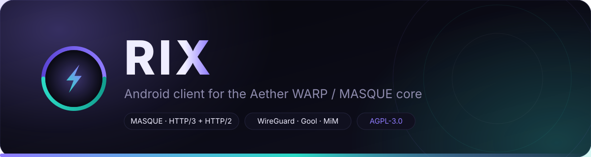
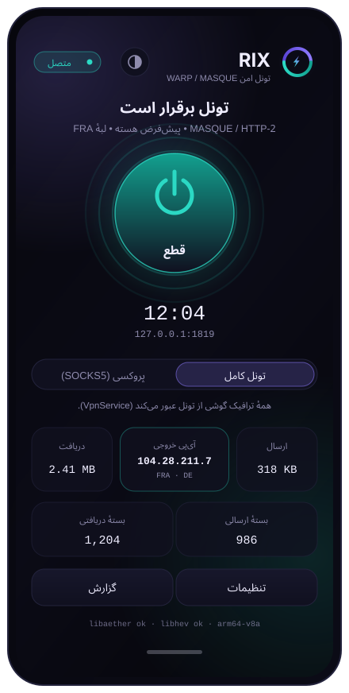
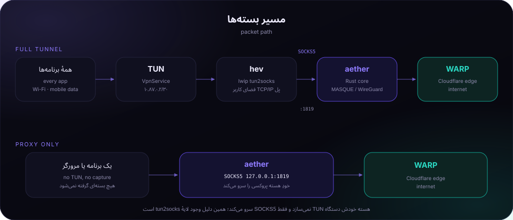

<div align="center">
  
  <h1>RIX-AETHER</h1>
  <h3>کنسول شبکه // اندروید + ویندوز</h3>
  <p><strong>اتصال واقعی، فقط وقتی تأیید می‌شود که ترافیک از تونل عبور کند و پاسخ برگردد.</strong></p>
  <p>توسعه و نگهداری: <a href="https://github.com/rix-reza">REZA-RIX</a></p>

  <p>
    <a href="https://github.com/RIX-REZA/RIX-AETHER/releases/latest"></a>
    <a href="https://github.com/RIX-REZA/RIX-AETHER/releases"></a>
    <a href="https://github.com/RIX-REZA/RIX-AETHER/actions/workflows/android-rix.yml"></a>
  </p>
  <p>
    <a href="README.md">English</a> · <strong>فارسی</strong> · <a href="https://github.com/RIX-REZA/RIX-AETHER/releases/latest">دانلود آخرین نسخه</a> · <a href="https://github.com/rix-reza">توسعه‌دهنده</a>
  </p>
</div>

---

<table>
  <tr>
    <td align="center" width="33%">
      <h3>🎯 مأموریت</h3>
      <strong>تأیید اتصال واقعی</strong><br>
      بدون سبزشدنِ نمایشی؛ RIX عبور واقعی درخواست از تونل را بررسی می‌کند.
    </td>
    <td align="center" width="33%">
      <h3>🧩 تجهیزات اتصال</h3>
      <strong>۶ روش ارتباطی</strong><br>
      MASQUE، HTTP/2، WireGuard و حالت‌های لایه‌ای.
    </td>
    <td align="center" width="33%">
      <h3>🖥️ پلتفرم‌ها</h3>
      <strong>اندروید + ویندوز</strong><br>
      VPN موبایل و کلاینت دسکتاپ سبک.
    </td>
  </tr>
</table>

<div align="center">
  
</div>

## 🕹️ مرکز فرماندهی

| ۰۱ · شروع | ۰۲ · امکانات | ۰۳ · معماری | ۰۴ · پشتیبانی |
|:---:|:---:|:---:|:---:|
| [دانلود](#-منطقه-دریافت) | [قابلیت‌ها](#-قابلیتهای-بازشده) | [نقشه شبکه](#-نقشه-شبکه) | [عیب‌یابی](#-پشتیبانی-مأموریت) |
| [مشخصات](#-شناسنامه-فنی) | [پروتکل‌ها](#-تجهیزات-ارتباطی) | [ساخت](#-کارگاه-ساخت) | [حریم خصوصی](#-حریم-خصوصی--مجوزها) |

## ⚡ منطقه دریافت

<div align="center">
  <a href="https://github.com/RIX-REZA/RIX-AETHER/releases/latest"></a>
</div>

| بسته | فایل آخرین انتشار ثبت‌شده | توضیحات |
|:--|:--|:--|
| **اندروید · ARMv7** | [`RIX-AETHER-Android-ARMv7.apk`](https://github.com/RIX-REZA/RIX-AETHER/releases/download/v1.0.7/RIX-AETHER-Android-ARMv7.apk) · ۲۵.۸ MiB | دستگاه‌های ۳۲ بیتی ARM، معماری `armeabi-v7a` |
| **اندروید · ARM64** | [`RIX-AETHER-Android-ARM64.apk`](https://github.com/RIX-REZA/RIX-AETHER/releases/download/v1.0.7/RIX-AETHER-Android-ARM64.apk) · ۲۶.۲ MiB | دستگاه‌های ۶۴ بیتی ARM، معماری `arm64-v8a` |
| **اندروید · Universal** | [`RIX-AETHER-Android-Universal.apk`](https://github.com/RIX-REZA/RIX-AETHER/releases/download/v1.0.7/RIX-AETHER-Android-Universal.apk) · ۴۱.۲ MiB | هر دو معماری ARM را دارد؛ اگر مطمئن نیستید این را بردارید |
| **ویندوز ۱۰ · پرتابل** | [`RIX-AETHER-Windows-10-Portable.zip`](https://github.com/RIX-REZA/RIX-AETHER/releases/download/v1.0.7/RIX-AETHER-Windows-10-Portable.zip) · ۸۴.۲ MiB | استخراج و اجرا؛ داده‌ها در پوشهٔ `data\` کنار `RIX.exe` می‌مانند |
| **ویندوز ۱۱ · پرتابل** | [`RIX-AETHER-Windows-11-Portable.zip`](https://github.com/RIX-REZA/RIX-AETHER/releases/download/v1.0.7/RIX-AETHER-Windows-11-Portable.zip) · ۸۴.۲ MiB | همان برنامهٔ پرتابل؛ حداقل سیستم‌عامل را ویندوز ۱۱ اعلام می‌کند |
| **ویندوز ۱۰ · دسکتاپ** | [`RIX-AETHER-Windows-10-Desktop-Setup.exe`](https://github.com/RIX-REZA/RIX-AETHER/releases/download/v1.0.7/RIX-AETHER-Windows-10-Desktop-Setup.exe) · ۷۶.۵ MiB | نصاب برای کاربر فعلی، ویندوز ۱۰ نسخه ۱۸۰۹ (build 17763) یا جدیدتر |
| **ویندوز ۱۱ · دسکتاپ** | [`RIX-AETHER-Windows-11-Desktop-Setup.exe`](https://github.com/RIX-REZA/RIX-AETHER/releases/download/v1.0.7/RIX-AETHER-Windows-11-Desktop-Setup.exe) · ۷۶.۵ MiB | نصاب برای کاربر فعلی، ویندوز ۱۱ (build 22000) یا جدیدتر |
| **هش‌ها** | [`SHA256SUMS.txt`](https://github.com/RIX-REZA/RIX-AETHER/releases/download/v1.0.7/SHA256SUMS.txt) | همهٔ فایل‌های بالا را پوشش می‌دهد؛ هر فایل یک فایل کنار `.sha256` هم دارد |
| **یادداشت انتشار** | [نسخه v1.0.7](https://github.com/RIX-REZA/RIX-AETHER/releases/tag/v1.0.7) | ساخت چندسکویی نسخه ۱.۰.۷ |

<details>
  <summary><strong>📦 یکپارچگی فایل انتشار · SHA-256</strong></summary>

  ```text
  da3143218eb27d5da7f71f136f063115579d48ebd531e2155a42c9e8c86a5d04  RIX-AETHER-Android-ARM64.apk
  589554c0cad3fce659c48a7bcf1221e53d072a01db253fa3724396b1b6ccf1b5  RIX-AETHER-Android-ARMv7.apk
  ceed2f6996df7118e859f7e3f287c0d46f884b064241ff2d5518749541e5358d  RIX-AETHER-Android-Universal.apk
  94c6f2cd714e5162e6324fa70e0bf9891fb59650040b3f9ec397775c6af59cb0  RIX-AETHER-Windows-10-Desktop-Setup.exe
  5bc766dc06c97bc3fa59bd00684bc60514be05f0dcbc28eb467471bcce2c5128  RIX-AETHER-Windows-10-Portable.zip
  aeeae5b6f372ac1b1215a3494398a910e972e6399ef13f2001e1eea1c20590fb  RIX-AETHER-Windows-11-Desktop-Setup.exe
  5bc766dc06c97bc3fa59bd00684bc60514be05f0dcbc28eb467471bcce2c5128  RIX-AETHER-Windows-11-Portable.zip
  ```
</details>

### 🧾 آیا این نسخه رسمی است؟

فقط از [صفحهٔ انتشارها](https://github.com/RIX-REZA/RIX-AETHER/releases) دانلود کن. هر منبع دیگری ساختِ شخص دیگری است، با هر امضایی که داشته باشد. برای فایل‌های چندسکویی فعلی دو بررسی در دسترس است:

۱. **هش.** فایل `SHA256SUMS.txt` هر هفت فایل منتشرشده را پوشش می‌دهد و هر فایل یک فایل کنار `<filename>.sha256` هم دارد. آن را با فایل دانلود‌شده مقایسه کن (`sha256sum -c SHA256SUMS.txt`). این فقط دانلود ناقص یا جابه‌جاشده را می‌گیرد و بس — هر کسی می‌تواند برای فایل خودش هش بگذارد.
۲. **امضای اندروید.** دستور `apksigner verify --print-certs RIX-AETHER-Android-Universal.apk` مقدار `CN=RIX VPN` و اثر انگشت SHA-256 گواهی `dc351af6…` را چاپ می‌کند. این ثابت می‌کند فایل با کلید *دیگری* امضا نشده؛ ولی ثابت نمی‌کند ساختِ ماست: آن کلید از زمانی که در همین مخزن کامیت شد عمومی است، پس یک فایل جعلی هم می‌تواند همان اثر انگشت را نشان دهد. توضیح کامل در [SECURITY.md](SECURITY.md) است و راه بیرون رفتن از این وضع، همان چرخش کلید.

فایل‌های چندسکویی توسط اجرای `43251153950` از ورکفلوی `multi-platform-release.yml` در کامیت `653cb50` ساخته شده‌اند (کتابخانه‌های Native و APKهای امضاشدهٔ اندروید روی لینوکس، فایل اجرایی و نصاب‌های ویندوز روی رانر x64 ویندوز). این فایل‌ها **attestation ساخت گیت‌هاب ندارند**، پس `gh attestation verify` برای این مجموعه در دسترس نیست. attestation قبلی `RIX-1.0.7-debug.apk` از `android-rix.yml` شامل هیچ‌کدام از فایل‌های این انتشار نمی‌شود.

اگر نسخهٔ تغییرداده‌ای را بازتوزیع می‌کنی، [TRADEMARK.md](TRADEMARK.md) فهرست می‌کند چه چیزهایی باید عوض شود: نام، شناسهٔ برنامه و آیکون‌ها. فورک آزاد است و این پروژه جلوی آن را نمی‌گیرد؛ آنچه اینجا می‌ماند نام و آیکون‌هاست.

> [!NOTE]
> نسخه **۱.۰.۷** رابط کاربری هر دو نسخه را از نو می‌سازد و علت لگ اندروید را برمی‌دارد: شمارنده‌های ترافیک در همان حالتی بودند که فاز اتصال در آن قرار داشت، پس هر خواندن — هر ثانیه، تا وقتی تونل بالا بود — کل صفحه را از نو می‌ساخت. حالا روی یک جریان جدا هستند و فقط ساعت جلسه، نمودار و دو کاشی ترافیک با آن‌ها به‌روز می‌شوند. گزارش زنده هم دیگر با هر خط، پیمایش انیمیشنی به انتها ندارد.
>
> انتشار چندسکویی همچنین APKهای جداگانهٔ ARMv7، ARM64 و Universal و نسخه‌های پرتابل و دسکتاپ ویندوز ۱۰ و ۱۱ را منتشر می‌کند. ویندوز فقط x64 است: هستهٔ Aether ویندوز در این نسخه x86_64 است، بنابراین بستهٔ ARM64 ویندوز منتشر نمی‌شود.
>
> [!IMPORTANT]
> کاربرانی که از نسخه **۱.۰.۲ یا قدیمی‌تر** ارتقا می‌دهند، باید نسخه قدیمی را یک‌بار حذف کنند؛ زیرا آن نسخه‌ها با امضای موقت و متغیر CI ساخته شده بودند. از نسخه ۱.۰.۳ به بعد از هویت امضای ثابت استفاده می‌شود که جزئیاتش در مخزن آمده است.

## 🏆 قابلیت‌های بازشده

<table>
  <tr>
    <td width="50%">
      <h3>🟢 بررسی اتصال واقعی</h3>
      RIX فقط با بازشدن سوکت وضعیت اتصال را اعلام نمی‌کند؛ منتظر می‌ماند درخواست واقعی از تونل عبور کند و پاسخ برگردد.
    </td>
    <td width="50%">
      <h3>🔁 جایگزینی هوشمند</h3>
      اگر یک روش ارتباطی نتواند اتصال را اثبات کند، RIX می‌تواند زنجیره‌ای رتبه‌بندی‌شده از گزینه‌های جایگزین را امتحان کند و روش موفق را به خاطر بسپارد.
    </td>
  </tr>
  <tr>
    <td>
      <h3>🧭 اسپلیت تانل</h3>
      عبور ترافیک همه برنامه‌ها، فقط برنامه‌های انتخاب‌شده یا همه به‌جز برنامه‌های انتخاب‌شده. خود RIX از تونل خودش مستثنا می‌ماند تا حلقه مسیریابی ایجاد نشود.
    </td>
    <td>
      <h3>📊 آمار زنده</h3>
      مشاهده شمارنده‌های ارسال و دریافت، تعداد بسته‌ها، مدت جلسه و اطلاعات خروجی تأییدشده.
    </td>
  </tr>
  <tr>
    <td>
      <h3>🎛️ پیش‌تنظیم‌های سریع</h3>
      پنج پروفایل برای حالت پیش‌فرض، پایداری، سرعت، مقاومت در برابر DPI و مصرف کمتر.
    </td>
    <td>
      <h3>🧰 کنترل پیشرفته</h3>
      گزینه‌های رایج هسته به کنترل‌های واقعی تبدیل شده‌اند و تنظیمات پیشرفته از فیلد آرگومان‌های دلخواه قابل دسترسی‌اند.
    </td>
  </tr>
</table>

- 🌗 پوسته تاریک، روشن و هماهنگ با سیستم.
- 🧾 گزارش زنده رنگی با امکان کپی و پاک‌کردن.
- 🌐 مسیر‌دهی IPv4 و IPv6 در تونل.
- 🧪 وضعیت‌های جداگانه: خاموش، آماده‌سازی، اتصال، بررسی، فعال و خطا.
- 🪜 نوار مراحل، هر مرحله را فقط با شاهد روشن می‌کند — هسته، شنونده، سایفون، تونل، خروج — پس شنونده‌ای که فقط پورت را باز کرده، هرگز به‌جای تونل نشان داده نمی‌شود.
- 🛑 ضربهٔ دوم روی دکمهٔ اتصال، تلاشی که هنوز در جریان است را لغو می‌کند.
- 🔒 طبق مستندات پروژه، برنامه حساب کاربری، SDK تحلیل‌گر، تبلیغات، تله‌متری یا سرویس گزارش خطا ندارد.

## 🧩 تجهیزات ارتباطی

| روش ارتباطی | ساختار | کاربرد |
|:--|:--|:--|
| **MASQUE / HTTP-3** | QUIC / UDP | تأخیر کم در شبکه‌هایی که UDP در دسترس است |
| **MASQUE / HTTP-2** | TLS / TCP 443 | گزینه جایگزین TCP هنگام مسدودبودن UDP |
| **WireGuard** | WireGuard | روش سبک در شبکه‌های قابل دسترس |
| **Gool** | WireGuard داخل MASQUE | ارتباط لایه‌ای |
| **Gool Classic** | WireGuard داخل WireGuard | روش کپسوله‌سازی جایگزین |
| **MASQUE-in-MASQUE** | MASQUE تو‌در‌تو | لایه‌بندی بیشتر با سربار بالاتر |

### 🎚️ انتخاب سریع پیش‌تنظیم

| پیش‌تنظیم | پروفایل پیکربندی |
|:--|:--|
| **پیش‌فرض** | تنظیمات اصلی هسته با MASQUE / HTTP-3 |
| **ایران · مقاوم** | MASQUE / HTTP-2 روی TCP 443، Fragment، اسکن کامل و جایگزینی خودکار |
| **سریع‌ترین** | MASQUE / HTTP-3 با Turbo Scan و پروفایل پرقدرت |
| **ضد DPI** | MASQUE-in-MASQUE با اسکن کامل و Fragment |
| **کم‌مصرف** | WireGuard با پروفایل کم‌مصرف و Keepalive طولانی‌تر |

## 🗺️ نقشه شبکه

<div align="center">
  
</div>

### تونل کامل دستگاه

```text
برنامه‌های اندروید
       │
       ▼
VpnService / TUN
       │
       ▼
پل hev tun2socks
       │
       ▼
SOCKS5 · 127.0.0.1:1819
       │
       ▼
هسته Rust پروژه Aether · libaether.so
       │
       ▼
WARP / MASQUE ─────────► اینترنت
```

### توالی اتصال

```text
خاموش ← آماده‌سازی ← اتصال ← بررسی ← فعال
                    │
                    └──────────────→ خطا
```

۱. RIX رابط TUN را می‌سازد و آدرس‌ها، DNS، مسیرها و قوانین اسپلیت تانل را اعمال می‌کند.
۲. گزینه ارتباطی را انتخاب می‌کند: انتخاب کاربر، آخرین روش موفق و سپس رتبه‌بندی پایداری.
۳. پیش از اجرای پل بسته‌ها، هسته باید پورت SOCKS5 را باز کند.
۴. موتور انتقال بسته شروع به کار می‌کند و زنده‌بودنش بررسی می‌شود.
۵. یک درخواست واقعی از مسیر SOCKS5 محلی ارسال می‌شود. اگر در مهلت تعیین‌شده پاسخ نرسد، گزینه جایگزین بعدی امتحان می‌شود.
۶. زمان جلسه فقط پس از تأیید تونل آغاز می‌شود.

<details>
  <summary><strong>⏱️ مهلت مراحل اتصال</strong></summary>

  | مرحله | مهلت |
  |:--|--:|
  | بازشدن SOCKS5 هسته | ۱۵ ثانیه |
  | تأیید گزینه اول | ۲۰ ثانیه |
  | تأیید هر گزینه جایگزین | ۱۰ ثانیه |
  | هر تلاش بررسی | ۶ ثانیه |
  | تعداد گزینه در هر تلاش | ۳ |
</details>

## 🎮 دو حالت عملکرد

| حالت | دریافت ترافیک | کاربرد |
|:--|:--|:--|
| **تونل کامل دستگاه** | برنامه‌ها از Android `VpnService` عبور می‌کنند | استفاده عادی برای کل دستگاه |
| **پروکسی SOCKS5** | بدون گرفتن ترافیک از طریق TUN | وقتی VPN دیگری فعال است یا فقط یک برنامه باید از پروکسی استفاده کند |

## 🖥️ ویندوز · نسخه دسکتاپ

نسخه ویندوز از همان هسته و منطق پروتکل‌ها با رابط دسکتاپ استفاده می‌کند.

| مورد | جزئیات |
|:--|:--|
| رابط کاربری | پنجرهٔ بدون قاب که صفحهٔ WebView2 جاسازی‌شده آن را می‌کشد، با گوشه‌های گرد در سیستم‌عامل‌هایی که این را پشتیبانی می‌کنند؛ همان نوار مراحل، نمودار و خوانش‌های گوشی |
| زبان و پوسته | فارسی و انگلیسی، روشن و تاریک |
| نصاب | دو نصاب برای کاربر فعلی: ویندوز ۱۰ نسخه ۱۸۰۹+ و ویندوز ۱۱ نسخه ۲۲۰۰۰+؛ بدون درایور و بدون درخواست دسترسی مدیر در مسیر عادی نصب |
| پرتابل | استخراج ZIP و اجرای `RIX.exe`؛ با وجود `portable.marker`، تنظیمات و داده‌ها در پوشهٔ `data\` کنار فایل اجرایی می‌مانند |
| حداقل سیستم‌عامل | ویندوز ۱۰ نسخه ۱۸۰۹ (build 17763) برای بستهٔ ویندوز ۱۰؛ ویندوز ۱۱ (build 22000) برای بستهٔ ویندوز ۱۱؛ فقط x64 |
| WebView2 | نصاب و بستهٔ پرتابل، بوت‌استرپر مایکروسافت را برای سیستم‌هایی که آن را ندارند همراه دارند |
| Psiphon | زنجیره ارتباطی آزمایشی (BETA) |

> [!WARNING]
> کلاینت فعلی ویندوز **پروکسی سیستمی مخصوص کاربر (WinINET)** را تنظیم می‌کند؛ این نسخه VPN تونلی سراسری مبتنی بر TUN نیست. Edge، Chrome، Office و برنامه‌هایی که از پروکسی ویندوز پیروی می‌کنند می‌توانند از آن استفاده کنند. برای Firefox باید پروکسی را دستی تنظیم کرد و بعضی برنامه‌ها که سوکت شبکه خودشان را باز می‌کنند ممکن است از پروکسی عبور نکنند. برای این برنامه‌ها می‌توان از SOCKS5 محلی استفاده کرد.

RIX پیش از تغییر پروکسی، مقادیر قبلی را ذخیره می‌کند تا در صورت توقف ناگهانی قابل بازیابی باشند. فرایند هسته نیز با Windows Job Object مدیریت می‌شود تا فرایندهای فرزند همراه برنامه بسته شوند.

## 🧪 شناسنامه فنی

| بخش | فناوری / نیازمندی |
|:--|:--|
| رابط اندروید | Kotlin · Jetpack Compose · Material 3 |
| هسته Native | هسته بالادستی Aether مبتنی بر Rust |
| تونل اندروید | `VpnService` + موتور `hev` tun2socks + SOCKS5 محلی |
| کلاینت ویندوز | برنامه دسکتاپ .NET |
| حداقل اندروید | Android 7.0 · API 24 |
| معماری‌های APK انتشار | `armeabi-v7a` · `arm64-v8a` · Universal (هر دو) |
| حداقل ویندوز | ویندوز ۱۰ نسخه ۱۸۰۹ (build 17763) یا ویندوز ۱۱ (build 22000) · x64 |
| مجوز | AGPL-3.0-only |

## 🛠️ کارگاه ساخت

هسته Native اندروید در CI ساخته می‌شود؛ چون وابستگی‌هایی مانند BoringSSL، quiche و boringtun باید با Android NDK به‌صورت Cross-Compile کامپایل شوند.

```bash
# ساخت و اعتبارسنجی انتشار چندسکویی بدون انتشار عمومی
gh workflow run multi-platform-release.yml -f release_tag=v1.0.7 -f publish=false

# برای کار فقط روی اندروید، ورکفلوی موجود هنوز فهرست ABI دلخواه را می‌سازد
gh workflow run android-rix.yml -f abis=arm64-v8a,armeabi-v7a
```

اگر کتابخانه‌های Native از قبل در مسیر محلی موجود باشند:

```bash
gradle :app:assembleRelease -PrixAbis=armeabi-v7a,arm64-v8a
```

مراحل اصلی ساخت ویندوز:

```powershell
dotnet publish windows/src/Rix.Windows.csproj -c Release -o windows/publish
ISCC.exe /DOutputBaseFilename=RIX-AETHER-Windows-10-Desktop-Setup /DMinWindows=10.0.17763 windows\installer\Rix.iss
ISCC.exe /DOutputBaseFilename=RIX-AETHER-Windows-11-Desktop-Setup /DMinWindows=10.0.22000 windows\installer\Rix.iss
```

برای جزئیات کامل، [ورکفلوی انتشار چندسکویی](.github/workflows/multi-platform-release.yml)، [ورکفلوی اندروید](.github/workflows/android-rix.yml) و [ورکفلوی ویندوز](.github/workflows/windows-rix.yml) را ببینید.

## 🧯 پشتیبانی مأموریت

| نشانه | اولین موردی که باید بررسی شود |
|:--|:--|
| هیچ پروتکلی وصل نمی‌شود | پیش‌تنظیم **ایران · مقاوم** را امتحان کنید یا جایگزینی خودکار را روشن کنید؛ گزارش زنده دلیل شکست هر روش را نشان می‌دهد. |
| روی «در حال اتصال» می‌ماند و بعد خطا می‌دهد | خطوط پایانی گزارش را بخوانید؛ ممکن است رفت‌وبرگشت واقعی تونل انجام نشده یا پورت محلی هسته باز نشده باشد. |
| موتور `tun2socks` متوقف می‌شود | دوباره وصل شوید و گزارش هسته را در خطوط پیش از توقف بررسی کنید. |
| پروکسی کار می‌کند ولی تونل کامل نه | بررسی کنید VPN دیگری سرویس `VpnService` را اشغال نکرده باشد و برنامه موردنظر در فهرست اسپلیت تانل مستثنا نشده باشد. |
| روی Wi-Fi کار می‌کند ولی روی دیتای موبایل نه | در دسترس‌بودن UDP و رسیدن زنجیره جایگزین به MASQUE / HTTP-2 را بررسی کنید. |
| Firefox از پروکسی ویندوز استفاده نمی‌کند | پروکسی Firefox را دستی تنظیم کنید یا آن را به `127.0.0.1:1819` وصل کنید. |
| مصرف باتری بالاست | پیش‌تنظیم **کم‌مصرف** را امتحان کنید و تنظیمات Keepalive و پروفایل عملکرد را بررسی کنید. |

## 🔐 حریم خصوصی و مجوزها

طبق مستندات پروژه، RIX سامانه حساب کاربری، SDK تحلیل‌گر، تبلیغات، تله‌متری یا سرویس گزارش خطا ندارد. تنظیمات به‌صورت محلی نگهداری می‌شوند. ترافیک Cleartext در Manifest اندروید غیرفعال است و Backup برنامه نیز غیرفعال شده است.

| مجوز اندروید | دلیل استفاده |
|:--|:--|
| `INTERNET`، `ACCESS_NETWORK_STATE` | دسترسی شبکه و وضعیت اتصال |
| `FOREGROUND_SERVICE`، `FOREGROUND_SERVICE_SPECIAL_USE` | فعال نگه‌داشتن سرویس VPN در پس‌زمینه |
| `POST_NOTIFICATIONS` | اعلان دائمی VPN در Android 13 به بعد |
| `WAKE_LOCK` | حفظ تونل هنگام خواب دستگاه |

VPN ناگزیر ترافیک را به نقطه پایانی بالادستی انتخاب‌شده ارسال می‌کند. برای شناخت این بخش از مسیر شبکه، پروژه بالادستی [Aether](https://github.com/CluvexStudio/Aether) و سیاست‌های آن را نیز بررسی کنید.

## 📁 نقشه فایل‌های پروژه

```text
RIX-AETHER/
├── .github/workflows/       انتشار چندسکویی + CI اندروید و ویندوز
├── app/src/main/cpp/        پل JNI و فایل‌های ساخت Native
├── app/src/main/java/       برنامه Kotlin، هسته، سرویس‌ها و رابط کاربری
├── docs/                    تصاویر و نمودارهای README
├── windows/                 کلاینت دسکتاپ و نصاب ویندوز
├── LICENSE                  مجوز AGPL-3.0-only
├── NOTICE                   اطلاعیهٔ انتساب و نام‌های تجاری
├── SECURITY.md              کلید امضای افشاشده و اقدام‌های انجام‌شده
├── TRADEMARK.md             قواعد نام و برند برای بازتوزیع
├── README.md                راهنمای انگلیسی پروژه
└── README.fa.md             راهنمای فارسی پروژه
```

## 🤝 اعتبارها، مجوز و نام‌گذاری

- **توسعه‌دهنده:** [REZA-RIX](https://github.com/rix-reza)
- **مخزن کد:** [RIX-REZA / RIX-AETHER](https://github.com/RIX-REZA/RIX-AETHER)
- **Aether:** هسته بالادستی Rust برای WARP / MASQUE از [CluvexStudio](https://github.com/CluvexStudio/Aether).
- **hev-socks5-tunnel:** پل فضای کاربر برای اتصال TUN به SOCKS5.
- **Cloudflare WARP:** سرویس شبکه‌ای که اجزای بالادستی با آن ارتباط دارند.

RIX یک اثر مشتق‌شده است و تحت مجوز **AGPL-3.0-only** منتشر می‌شود. فایل‌های [LICENSE](LICENSE) و [NOTICE](NOTICE) را ببینید. نام نمایشی خود برنامه **RIX** است. نام مخزن، زمینه یکپارچه‌سازی فنی را مشخص می‌کند و به معنای مالکیت یا تأیید از سوی پروژه بالادستی Aether نیست. سیاست نام‌گذاری و علامت تجاری پروژه بالادستی معتبر است؛ بدون اجازه کتبی دارنده حقوق، Aether را به‌عنوان نام تجاری اختصاصی برنامه معرفی نکنید.

نام و آثار هنری خود این پروژه در [TRADEMARK.md](TRADEMARK.md) پوشش داده شده است؛ همان‌جا مشخص می‌کند یک بازتوزیع باید چه چیزهایی را عوض کند. این شرایط، شرط‌های اضافه‌ای است که این پروژه طبق بند ۷(ب) و بند ۷(پ) مجوز AGPL تعیین می‌کند، و همین است که باعث می‌شود یک فورک با نام خودش منتشر شود، نه با نام این پروژه.

---

<div align="center">
  <strong>RIX-AETHER // ساخته‌شده توسط REZA-RIX</strong><br>
  <sub>برای شبکه‌هایی ساخته شده که به‌سختی کار می‌کنند.</sub><br><br>
  <a href="https://github.com/RIX-REZA/RIX-AETHER/stargazers">⭐ به پروژه ستاره بدهید</a> ·
  <a href="https://github.com/RIX-REZA/RIX-AETHER/issues">🐛 گزارش مشکل</a> ·
  <a href="https://github.com/RIX-REZA/RIX-AETHER/releases">🚀 مشاهده انتشارها</a>
</div>
