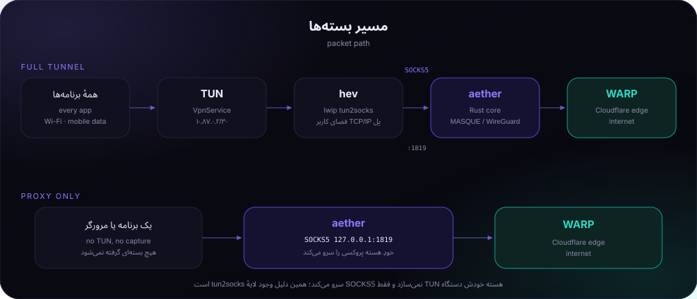

[README.md](https://github.com/user-attachments/files/34220601/README.md)
<div align="center">
  
  <h1>RIX-AETHER</h1>
  <h3>NETWORK CONTROL // ANDROID + WINDOWS</h3>
  <p><strong>A connection is only real when traffic makes it through.</strong></p>
  <p>Developed and maintained by <a href="https://github.com/rix-reza">REZA-RIX</a></p>

  <p>
    <a href="https://github.com/RIX-REZA/RIX-AETHER/releases/latest"></a>
    <a href="https://github.com/RIX-REZA/RIX-AETHER/releases"></a>
    <a href="https://github.com/RIX-REZA/RIX-AETHER/actions/workflows/android-rix.yml"></a>
  </p>
  <p>
    <a href="README.md"><strong>ENGLISH</strong></a> · <a href="README.fa.md">فارسی</a> · <a href="https://github.com/RIX-REZA/RIX-AETHER/releases/latest">DOWNLOAD</a> · <a href="https://github.com/rix-reza">DEVELOPER</a>
  </p>
</div>

---

<table>
  <tr>
    <td align="center" width="33%">
      <h3>🎯 MISSION</h3>
      <strong>Verified connectivity</strong><br>
      No fake green state. RIX verifies a real request through the tunnel.
    </td>
    <td align="center" width="33%">
      <h3>🧩 LOADOUT</h3>
      <strong>6 transport options</strong><br>
      MASQUE, HTTP/2, WireGuard and layered modes.
    </td>
    <td align="center" width="33%">
      <h3>🖥️ PLATFORMS</h3>
      <strong>Android + Windows</strong><br>
      Mobile VPN and a lightweight desktop client.
    </td>
  </tr>
</table>

<div align="center">
  
</div>

## 🕹️ COMMAND CENTER

| 01 · START | 02 · EXPLORE | 03 · UNDER THE HOOD | 04 · SUPPORT |
|:---:|:---:|:---:|:---:|
| [Downloads](#-deployment-zone) | [Features](#-feature-unlocks) | [Architecture](#-network-map) | [Troubleshooting](#-mission-support) |
| [Quick facts](#-system-profile) | [Transports](#-transport-loadout) | [Build](#-build-lab) | [Privacy](#-privacy--permissions) |

## ⚡ DEPLOYMENT ZONE

<div align="center">
  <a href="https://github.com/RIX-REZA/RIX-AETHER/releases/latest"></a>
</div>

| Package | Latest published artifact | Notes |
|:--|:--|:--|
| **Android** | [`RIX-1.0.6-debug.apk`](https://github.com/RIX-REZA/RIX-AETHER/releases/download/v1.0.6/RIX-1.0.6-debug.apk) · 33.2 MB | Android package; see release notes before installing |
| **Windows Installer** | [`RIX-Setup-1.0.6.exe`](https://github.com/RIX-REZA/RIX-AETHER/releases/download/v1.0.6/RIX-Setup-1.0.6.exe) · 76.5 MB | Per-user installer |
| **Windows Portable** | [`RIX-Portable.zip`](https://github.com/RIX-REZA/RIX-AETHER/releases/download/v1.0.6/RIX-Portable.zip) · 82.5 MB | Extract and run; no installation step |
| **Release Bundle** | [`RIX-1.0.6.zip`](https://github.com/RIX-REZA/RIX-AETHER/releases/download/v1.0.6/RIX-1.0.6.zip) | APK, install notes and release notes |
| **Release Notes** | [v1.0.6](https://github.com/RIX-REZA/RIX-AETHER/releases/tag/v1.0.6) | Bug-fix release |

<details>
  <summary><strong>📦 Release integrity · SHA-256</strong></summary>

  ```text
  ba6b13a7b2dfe4491d06b4f1d01081d13e70cd59e894694c257cb1c47d43eb8a
  ```
</details>

> [!NOTE]
> Version **1.0.6** is a bug-fix release. It fixes the Android Psiphon error reporting and VPN teardown, and prevents a Windows disconnect/reconnect while a fallback attempt replaces the core.
>
> [!IMPORTANT]
> Users upgrading from **1.0.2 or older** must uninstall the old build once because those versions used a changing CI debug signature. Builds from **1.0.3 onward** use the fixed signing identity documented in the repository.

## 🏆 FEATURE UNLOCKS

<table>
  <tr>
    <td width="50%">
      <h3>🟢 REAL CONNECTION CHECK</h3>
      RIX does not mark a session as connected just because a socket opened. It waits for a real request to travel through the tunnel and return.
    </td>
    <td width="50%">
      <h3>🔁 SMART FALLBACK</h3>
      When a transport cannot prove connectivity, RIX can try a ranked fallback chain and remember the transport that worked.
    </td>
  </tr>
  <tr>
    <td>
      <h3>🧭 SPLIT TUNNEL</h3>
      Route all apps, selected apps, or all apps except the ones you choose. The RIX app is excluded from its own tunnel to avoid routing loops.
    </td>
    <td>
      <h3>📊 LIVE TELEMETRY</h3>
      View upload/download counters, packet counts, session duration and the verified egress details.
    </td>
  </tr>
  <tr>
    <td>
      <h3>🎛️ QUICK PRESETS</h3>
      Switch between five presets for default, resilient, speed, DPI-resistance and low-power use.
    </td>
    <td>
      <h3>🧰 DEEP CONTROL</h3>
      Common core settings are exposed as controls; advanced options remain available through the custom-arguments field.
    </td>
  </tr>
</table>

- 🌗 Dark, light and follow-system appearance.
- 🧾 Live, colour-coded logs that can be copied or cleared.
- 🌐 IPv4 and IPv6 tunnel routes.
- 🧪 Visible connection stages: idle, preparing, connecting, verifying, running and error.
- 🔒 No account, analytics SDK, ads, telemetry or crash-reporting service is built into the app, as documented by the project.

## 🧩 TRANSPORT LOADOUT

| Transport | Underlying mode | What it is useful for |
|:--|:--|:--|
| **MASQUE / HTTP-3** | QUIC / UDP | Low-latency path when UDP is available |
| **MASQUE / HTTP-2** | TLS / TCP 443 | TCP fallback when UDP is blocked |
| **WireGuard** | WireGuard | Lightweight transport where it is reachable |
| **Gool** | WireGuard inside MASQUE | Layered transport option |
| **Gool Classic** | WireGuard inside WireGuard | Alternative encapsulation mode |
| **MASQUE-in-MASQUE** | Nested MASQUE | Additional encapsulation at the cost of extra overhead |

### 🎚️ QUICK PRESET SELECTOR

| Preset | Configuration profile |
|:--|:--|
| **Default** | Core defaults with MASQUE / HTTP-3 |
| **Iran · Resilient** | MASQUE / HTTP-2 over TCP 443, fragmentation, thorough scan and fallback |
| **Fastest** | MASQUE / HTTP-3 with turbo scan and high-performance profile |
| **Anti-DPI** | MASQUE-in-MASQUE with thorough scan and fragmentation |
| **Low Power** | WireGuard with low-power profile and longer keepalive |

## 🗺️ NETWORK MAP

<div align="center">
  
</div>

### Full-device tunnel

```text
ANDROID APPS
     │
     ▼
VpnService / TUN
     │
     ▼
hev tun2socks bridge
     │
     ▼
SOCKS5 · 127.0.0.1:1819
     │
     ▼
Aether Rust core · libaether.so
     │
     ▼
WARP / MASQUE ─────────► INTERNET
```

### Connection sequence

```text
IDLE → PREPARING → CONNECTING → VERIFYING → RUNNING
                         │
                         └──────────────→ ERROR
```

1. RIX creates the TUN interface and applies addresses, DNS, routes and split-tunnel rules.
2. It selects a transport candidate: your choice, the last known-good transport, then the resilience ranking.
3. The core must open its SOCKS5 endpoint before the packet bridge is started.
4. The packet engine is started and checked.
5. A real request is sent through the local SOCKS5 path. If it does not return within the attempt budget, the next eligible candidate is tried.
6. The session clock starts only after the tunnel is verified.

<details>
  <summary><strong>⏱️ Connection budgets</strong></summary>

  | Stage | Budget |
  |:--|--:|
  | Core opens SOCKS5 | 15 s |
  | First candidate is verified | 20 s |
  | Each fallback candidate | 10 s |
  | Single probe | 6 s |
  | Candidates per attempt | 3 |
</details>

## 🎮 TWO OPERATING MODES

| Mode | Traffic capture | Use case |
|:--|:--|:--|
| **Full-device VPN** | Apps routed through Android `VpnService` | Normal device-wide VPN usage |
| **SOCKS5 Proxy** | No TUN capture | Use when another VPN owns the device or only one app needs the proxy |

## 🖥️ WINDOWS · DESKTOP STAGE

The Windows client uses the same core and transport logic, with a desktop interface.

| Item | Details |
|:--|:--|
| Installer | Per-user setup; no driver and no administrator prompt for the normal install path |
| Portable | Extract the ZIP and run `RIX.exe` |
| Minimum OS | Windows 10 version 1809 or newer, 64-bit |
| WebView2 | The installer provides it when it is missing |
| Psiphon | BETA transport chain |

> [!WARNING]
> The current Windows client configures the **per-user Windows system proxy (WinINET)**; it is not a full-device TUN VPN. Edge, Chrome, Office and other applications that respect the Windows proxy can use it. Firefox needs manual proxy configuration, and applications that open their own network sockets may bypass it. The local SOCKS5 endpoint is available for applications that support manual proxy settings.

RIX also records the previous proxy values before changing them and restores them after an interrupted session. Its core process is managed with a Windows Job Object so child processes are closed with the app.

## 🧪 SYSTEM PROFILE

| Component | Technology / requirement |
|:--|:--|
| Android UI | Kotlin · Jetpack Compose · Material 3 |
| Native core | Rust-based upstream Aether core |
| Android tunnel | `VpnService` + `hev` tun2socks + local SOCKS5 |
| Windows client | .NET desktop application |
| Android minimum | Android 7.0 · API 24 |
| Released Android ABI | `arm64-v8a` |
| Windows minimum | Windows 10 1809 · 64-bit |
| License | AGPL-3.0-only |

## 🛠️ BUILD LAB

The Android native core is built in CI because its dependencies (including BoringSSL, quiche and boringtun) require cross-compilation with the Android NDK.

```bash
# Run the default Android build (arm64-v8a)
gh workflow run android-rix.yml

# Request additional Android ABIs
gh workflow run android-rix.yml -f abis=arm64-v8a,armeabi-v7a,x86_64
```

When the native libraries are already present locally:

```bash
gradle :app:assembleDebug -PrixAbis=arm64-v8a
```

Windows build outline:

```powershell
dotnet publish windows/src/Rix.Windows.csproj -c Release -o windows/publish
ISCC.exe windows\installer\Rix.iss
```

See the [Android workflow](.github/workflows/android-rix.yml) and [Windows workflow](.github/workflows/windows-rix.yml) for the complete CI build process.

## 🧯 MISSION SUPPORT

| Symptom | First thing to check |
|:--|:--|
| Nothing connects | Try **Iran · Resilient** or enable automatic protocol fallback; inspect the live log for each failed transport. |
| Stays on connecting, then errors | Read the last log lines: the tunnel may not have completed a real round trip or the core may not have opened its local port. |
| `tun2socks` stops | Reconnect and inspect the core log immediately before the stop event. |
| Proxy mode works, full tunnel does not | Check whether another Android `VpnService` is active and review split-tunnel app selection. |
| Works on Wi-Fi, not mobile data | Check UDP availability and whether the fallback reached MASQUE / HTTP-2. |
| Firefox does not use Windows proxy | Configure Firefox's proxy settings manually or point it to `127.0.0.1:1819`. |
| Battery drain | Try the **Low Power** preset and review keepalive and performance settings. |

## 🔐 PRIVACY / PERMISSIONS

The project documents that RIX has no account system, analytics SDK, ads, telemetry or crash-reporting service. Settings are stored locally. Android cleartext traffic is disabled in the manifest, and backup is disabled.

| Android permission | Purpose |
|:--|:--|
| `INTERNET`, `ACCESS_NETWORK_STATE` | Network access and connectivity state |
| `FOREGROUND_SERVICE`, `FOREGROUND_SERVICE_SPECIAL_USE` | Keep the VPN service running when the app is in the background |
| `POST_NOTIFICATIONS` | Persistent VPN notification on Android 13+ |
| `WAKE_LOCK` | Keep the tunnel active while the device sleeps |

A VPN necessarily sends traffic to the configured upstream endpoint. Review the upstream [Aether project](https://github.com/CluvexStudio/Aether) and its policies to understand that part of the network path.

## 📁 PROJECT MAP

```text
RIX-AETHER/
├── .github/workflows/       Android + Windows CI
├── app/src/main/cpp/        JNI bridge and native build files
├── app/src/main/java/       Kotlin app, core, services and UI
├── docs/                    README artwork and architecture diagrams
├── windows/                 Windows desktop client and installer
├── README.md                English project guide
└── README.fa.md             Persian project guide
```

## 🤝 CREDITS, LICENSE & NAMING

- **Developer:** [REZA-RIX](https://github.com/rix-reza)
- **Source repository:** [RIX-REZA / RIX-AETHER](https://github.com/RIX-REZA/RIX-AETHER)
- **Aether:** upstream Rust WARP / MASQUE core by [CluvexStudio](https://github.com/CluvexStudio/Aether).
- **hev-socks5-tunnel:** userspace TUN-to-SOCKS5 bridge.
- **Cloudflare WARP:** network service used by the upstream components.

RIX is a derivative work and is licensed under **AGPL-3.0-only**. See [LICENSE](LICENSE) and [NOTICE](NOTICE). The application itself is named **RIX**. The repository name identifies its integration context; it does not imply ownership of, or endorsement by, the upstream Aether project. The upstream naming and trademark policy applies; do not present Aether as the app's own brand without written permission from the relevant rights holder.

---

<div align="center">
  <strong>RIX-AETHER // BUILT BY REZA-RIX</strong><br>
  <sub>Built for networks that fight back.</sub><br><br>
  <a href="https://github.com/RIX-REZA/RIX-AETHER/stargazers">⭐ Star the project</a> ·
  <a href="https://github.com/RIX-REZA/RIX-AETHER/issues">🐛 Report an issue</a> ·
  <a href="https://github.com/RIX-REZA/RIX-AETHER/releases">🚀 View releases</a>
</div>
