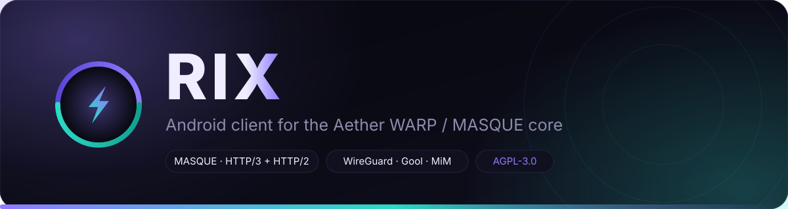
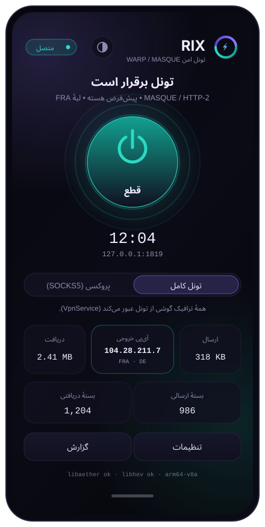

<div align="center">



<br>

[](https://github.com/amirmayeli1211/hermes-data/releases)
[](https://github.com/amirmayeli1211/hermes-data/releases)
[](https://github.com/amirmayeli1211/hermes-data/actions/workflows/android-rix.yml)
[](LICENSE)

[](#compatibility)
[](app/build.gradle.kts)
[](app/src/main/java/com/rix/vpn/ui)
[](https://github.com/CluvexStudio/Aether)
[](#abis)

**English** · [فارسی](README.fa.md)

</div>

---

RIX is a Material 3 Android front end for [Aether](https://github.com/CluvexStudio/Aether),
a Rust userspace WARP core built around MASQUE over HTTP/3 and HTTP/2.

It does **not** reimplement the tunnel. It packages the upstream core as
`libaether.so`, adds a userspace TCP/IP bridge so Android can hand it a
`VpnService` descriptor, and drives both from Kotlin — with one rule the app
takes seriously: **it is not allowed to say «متصل» until a real request has come
back through the tunnel.**

<div align="center">

</div>

## Contents

- [Download](#download)
- [What makes it different](#what-makes-it-different)
- [Features](#features)
- [How it works](#how-it-works)
- [Modes](#modes)
- [Settings reference](#settings-reference)
- [Building](#building)
- [Installing and updating](#installing-and-updating)
- [Troubleshooting](#troubleshooting)
- [Privacy](#privacy)
- [Compatibility](#compatibility)
- [Licence and naming](#licence-and-naming)

## Download

| | |
|---|---|
| **APK** | [`RIX-1.0.3-debug.apk`](https://github.com/amirmayeli1211/hermes-data/releases/download/v1.0.3/RIX-1.0.3-debug.apk) · 22.2 MB |
| **Bundle** | [`RIX-1.0.3.zip`](https://github.com/amirmayeli1211/hermes-data/releases/download/v1.0.3/RIX-1.0.3.zip) · APK + install notes + release notes |
| **Release** | [v1.0.3](https://github.com/amirmayeli1211/hermes-data/releases/tag/v1.0.3) |
| **sha256** | `925499d185d674269160ec69c4e5b3e766ccfa0f402cbc99cd2da410ccd25328` |

> [!IMPORTANT]
> **One last clean install.** Everything up to 1.0.2 was signed with Gradle's
> throwaway debug key, which is regenerated on every CI runner — so each release
> carried a different signature and Android refused to install over the previous
> one. If you are coming from 1.0.2 or older, uninstall once. From 1.0.3 the APK
> is signed with a fixed key and later versions install straight over it.

## What makes it different

**A connected label has to be earned.** Every other client in this space flips
the toggle to green the moment its socket opens. RIX waits: after the core is
listening and the packet engine is alive, it sends an HTTP request through the
tunnel to `cloudflare.com/cdn-cgi/trace` and only turns green when the answer
comes back. The `ip=`, `colo=` and `loc=` fields in that answer are the numbers
shown on the home screen — the tunnel's real egress, not a guess.

**One protocol is not a plan.** WireGuard and MASQUE/HTTP-3 are UDP-first, and
UDP is the first thing a filtered network drops. A fixed transport therefore
means «وصل نمیشود» rather than "a bit slower", which is exactly what users on
Iranian mobile networks were seeing. RIX tries a short ranked chain of
transports instead and keeps the one that demonstrably carried traffic.

**The wait is visible and bounded.** Idle, preparing, connecting, verifying,
running and error are distinct states with their own copy, so a slow network
never looks like a dead button, and a failure leaves its reason on screen
instead of silently resetting to idle.

## Features

| | |
|---|---|
| **Two modes** | Full-device tunnel through `VpnService`, or a local SOCKS5 proxy with no capture at all |
| **Automatic transport fallback** | Walks a resilience-ranked chain when the chosen protocol cannot prove a tunnel, and remembers what worked |
| **Real-traffic verification** | Green only after an actual round trip through the core, with the egress IP, Cloudflare edge and country on screen |
| **Six transports** | MASQUE/HTTP-3, MASQUE/HTTP-2, WireGuard, Gool, Gool Classic, MASQUE-in-MASQUE |
| **Split tunnelling** | All apps, only chosen apps, or all except chosen apps — with the app itself always excluded so the core's own sockets cannot loop back into its tunnel |
| **Live session stats** | Up/down counters, packet counters, session clock, and the assigned IP between them |
| **Presets** | Five one-tap configurations, including **ایران (مقاوم)** — MASQUE/HTTP-2 on TCP 443 with ClientHello fragmentation and a thorough scan |
| **ClientHello fragmentation** | DPI workaround with configurable size and delay |
| **Dark and light skins** | Hand-tuned palettes, plus follow-system, switchable from the header |
| **Live log** | Colour-coded, copyable, clearable — including which transport failed and why |
| **Full option surface** | ~136 core flags, the common ones promoted to real controls and the rest reachable through a quoted-token **آرگومانهای دلخواه** field |
| **No accounts, no telemetry** | No analytics SDK, no sign-in, no crash reporting, cleartext traffic disabled at the manifest level |

## How it works

### Packet path

Full-tunnel mode:

```text
every app ─▶ TUN (VpnService) ─▶ libhev-socks5-tunnel.so (lwip tun2socks)
          ─▶ SOCKS5 127.0.0.1:1819 ─▶ libaether.so ─▶ WARP / MASQUE ─▶ internet
```

Proxy mode: no TUN, no capture. `libaether.so` alone serves a local SOCKS5
endpoint that you point a browser or one app at.

The upstream core does **not** create a TUN device — it only serves SOCKS5 —
which is why the tun2socks layer exists at all. RIX builds the TUN, hands the
raw descriptor to `hev`, and lets `hev` open a fresh SOCKS5 connection per flow.

### Connection sequence

```text
IDLE ─▶ STARTING ─▶ CONNECTING ─▶ RUNNING
                       │
                       └─▶ ERROR            the reason stays on screen
```

1. **Establish the TUN** — addresses, MTU, DNS, routes, split-tunnel rules.
2. **Pick the candidate chain** — your chosen transport first, then the last
   transport that worked on this device, then the resilience ranking.

   ```text
   your pick ─▶ last good ─▶ MASQUE/H2 (TCP 443) ─▶ Gool ─▶ MASQUE-in-MASQUE
   ```

   Capped at three candidates per attempt; fragmentation is forced on for the
   fallbacks because that is the DPI workaround they exist for. The chain is
   skipped entirely when **چرخش خودکار پروتکل** is off.
3. **Start the core** and wait for its SOCKS5 port to actually accept a
   connection — a hard gate, not a sleep.
4. **Start tun2socks** once, against whichever core won, and confirm it stays
   alive past its first milliseconds.
5. **Prove the tunnel** — a real HTTP request out through the SOCKS5 port and
   back. No answer inside the budget, and the next candidate is tried.

   | Stage | Budget |
   |---|---|
   | Core opens its SOCKS5 port | 15 s |
   | First candidate proven | 20 s |
   | Each fallback proven | 10 s |
   | Single probe attempt | 6 s |
   | Candidates per attempt | 3 |
6. **Mark running** — the session clock starts *here*, not when the toggle was
   tapped, so it measures time connected rather than time spent connecting.

The winning transport is written to `SharedPreferences`, so a second connect
goes straight to it instead of re-learning what the network blocks.

### The tun2socks latch

`hev` keeps its run/stop handshake in a single module-global word, and a `stop()`
issued after teardown latches a bit that makes the *next* `run()` return
immediately with `rc=0` — indistinguishable from "the engine died on its own".
Every retry then fails too. `RixRuntime` therefore never calls `stop()` unless a
`run()` is genuinely in flight, treats a spontaneous zero return as a consumed
latch, and guards both with a generation token. The reasoning is documented at
the call site in [`RixRuntime.kt`](app/src/main/java/com/rix/vpn/core/RixRuntime.kt).

## Modes

| Mode | Capture | Use it when |
|---|---|---|
| **تونل کامل** | every app, via `VpnService` | normal use — the whole phone goes through WARP |
| **پروکسی (SOCKS5)** | none | another VPN already owns the phone, or only one app should be tunnelled |

The app always excludes itself from its own tunnel in full-tunnel mode; without
that the core's WARP sockets would be routed back into the TUN and deadlock.

## Settings reference

### Transports

| Transport | Flag | Notes |
|---|---|---|
| MASQUE / HTTP-3 | `--masque` | QUIC. Lowest latency, best throughput on mobile. |
| MASQUE / HTTP-2 | `--masque --h2` | HTTP/2 over TLS on TCP 443. Immune to UDP blocking — the first fallback, and the most reliable choice on filtered networks. |
| WireGuard | `--wg` | Plain WireGuard. Lightest and cheapest on battery, but usually blocked where it matters. |
| Gool | `--gool` | WireGuard inside MASQUE. Middle ground between stability and camouflage. |
| Gool Classic | `--gool-classic` | WireGuard inside WireGuard. For very strict networks. |
| MASQUE in MASQUE | `--mim` | Two MASQUE layers. Maximum DPI resistance for a little extra latency. |

### Presets

| Preset | What it sets |
|---|---|
| **پیشفرض** | Core defaults: MASQUE/HTTP-3, default scan. |
| **ایران (مقاوم)** | MASQUE/HTTP-2 on TCP 443, fragmentation on, thorough scan, fallback enabled. |
| **سریعترین** | MASQUE/HTTP-3, turbo scan, high-performance profile. |
| **ضد DPI** | MASQUE-in-MASQUE, thorough scan, fragmentation. |
| **کممصرف** | WireGuard, low-power profile, long keepalive. |

### Settings groups

<details>
<summary><b>مسیر اتصال</b> — transport, scan mode, Ironclad, automatic fallback</summary>

Transport selection with per-option descriptions, scan mode
(default/turbo/balanced/thorough/verified/ironclad), the **Ironclad** switch
(each candidate is accepted only after real traffic crosses it), and
**چرخش خودکار پروتکل**.

</details>

<details>
<summary><b>شبکه</b> — SOCKS5 port, MTU, IP family, DNS</summary>

Default port `1819`, MTU `1500`, IPv4, DNS `1.1.1.1,1.0.0.1`. The TUN is built
with both `10.87.0.2/30` and `fd00:87::2/126`, and IPv6 is routed as well as
IPv4 — leaving it unrouted would leak v6 traffic outside the tunnel on
dual-stack carriers.

</details>

<details>
<summary><b>اسپلیت تانل</b> — which apps are captured, and an app picker</summary>

All apps / only chosen / all except chosen, plus the **exclude this app** switch
that keeps the core's own sockets out of the tunnel.

</details>

<details>
<summary><b>رفتار اتصال</b> — reconnects, keepalive, fragmentation</summary>

Reconnect delay (default 2 s), keepalive (default 5 s), quick reconnect (reuse
the last working gateway instead of rescanning), and ClientHello fragmentation
with `fragment-size` / `fragment-delay`.

</details>

<details>
<summary><b>منابع و گزارش</b> — performance profile and log level</summary>

`low` / `medium` / `high` core profile, and `error` … `trace` logging.

</details>

<details>
<summary><b>پیشرفته</b> — manual gateway, upstream proxy, ECH, routes</summary>

`--exit-loc`, a manual peer, `--masque-sni`, an upstream `--http-proxy`, ECH,
and `--route-direct` / `--route-block` lists.

</details>

<details>
<summary><b>آرگومانهای دلخواه هسته</b> — the escape hatch</summary>

The core has ~136 flags. Anything not promoted is typed here verbatim,
whitespace-separated with `"quoted values"` honoured, and appended **last** so
it wins over everything the UI set.

</details>

## Building

CI does it, and that is not a preference — `libaether.so` needs BoringSSL,
quiche and boringtun cross-compiled with the NDK, which does not fit in a small
container. The workflow is
[`android-rix.yml`](../../.github/workflows/android-rix.yml) and runs three jobs
cheapest-first: **kotlin** type-checks in ~4 minutes so a typo never burns a
40-minute native build, **native** builds the libraries per ABI in a matrix, and
**apk** packages them and refuses to upload unless all three `.so` files are
actually inside the APK.

```sh
# the default (arm64-v8a only)
gh workflow run android-rix.yml

# more ABIs
gh workflow run android-rix.yml -f abis=arm64-v8a,armeabi-v7a,x86_64
```

Locally, with the native libraries already in `app/src/main/jniLibs/<abi>/`:

```sh
cd projects/rix
gradle :app:assembleDebug -PrixAbis=arm64-v8a     # API 24+, JDK 17 target
```

### ABIs

`arm64-v8a` is what the release ships. Other ABIs are built on demand through
the `abis` input; the Gradle `abiFilters` are driven by that same list so the
APK can never advertise an ABI whose `libaether.so` was not built.

### Toolchain

Android Gradle Plugin 8.7.3 · Gradle 8.9 · Kotlin 2.0.21 · Compose BOM
2024.10.01 · compileSdk 35, minSdk 24, targetSdk 34 · NDK 26.1.10909125 ·
CMake 3.22.1 · JDK 21 in CI, JVM target 17.

## Installing and updating

The APK is signed with a **fixed key committed to this repository**
(`keystore/rix.p12`, alias `rix`) so that consecutive releases share a
signature — that is the whole reason Android will now update the app in place
instead of demanding an uninstall. CI overwrites that file from the
`RIX_KEYSTORE_B64` secret when one exists, so moving to a private key later
needs no code change, and the build prints the certificate it used:

```text
V2 Signer: certificate DN: C=IR, O=RIX, CN=RIX VPN
```

> [!NOTE]
> The repository is public, so this key is public too. It exists for signature
> *consistency*, not for secrecy — it is not a Play Store upload key and it does
> not vouch for anything. Do not treat an APK signed with it as proof of
> authorship.

## Troubleshooting

| Symptom | What to do |
|---|---|
| Nothing connects, WireGuard especially | Settings → preset **ایران (مقاوم)**, or make sure **چرخش خودکار پروتکل** is on. The log names each transport it tried and why it failed. |
| Stuck on «در حال اتصال» then an error | The tunnel never proved itself. Open **گزارش**: either no transport completed a round trip (network blocks everything the chain offers) or the core never opened its port. |
| «موتور tun2socks متوقف شد» | The packet engine exited while the session was live. Reconnect; if it repeats, the log line above it names the core's last words. |
| Install refused with a signature error | You are updating over a build from 1.0.2 or older. Uninstall once, then install. |
| Proxy mode works, tunnel mode does not | Another VPN may already own the phone; Android allows one active `VpnService`. Also check split tunnelling — if the app you are testing is excluded, it will not be tunnelled. |
| Works on Wi-Fi, not on mobile data | Carrier-level UDP blocking or CGNAT. The chain should already be falling through to HTTP/2; if the log shows every candidate failing, the block is deeper than the app can route around. |
| Battery drain | Preset **کممصرف**, or raise keepalive and set the performance profile to `low`. |

## Privacy

No accounts, no sign-in, no analytics, no telemetry, no crash reporting, no
ads. `usesCleartextTraffic="false"` and `allowBackup="false"` in the manifest,
and `SYSTEM_ALERT_WINDOW` is explicitly removed. Settings live in
`DataStore`/`SharedPreferences` on the device and nowhere else.

The app does make one unencrypted-to-the-far-end assumption: it is a VPN client,
so it necessarily sends your traffic to the WARP endpoint you connect to. Read
the [Aether](https://github.com/CluvexStudio/Aether) project for what the core
does with it.

Permissions, and why each exists:

| Permission | Why |
|---|---|
| `INTERNET`, `ACCESS_NETWORK_STATE` | the tunnel itself |
| `FOREGROUND_SERVICE`, `FOREGROUND_SERVICE_SPECIAL_USE` | a VPN must keep running with the screen off |
| `POST_NOTIFICATIONS` | the ongoing status notification on Android 13+ |
| `WAKE_LOCK` | keep the tunnel alive while the device sleeps |

## Compatibility

- Android 7.0 (API 24) and newer; built against API 35, targeting API 34.
- `arm64-v8a` in the released APK; `armeabi-v7a` and `x86_64` on request via CI.
- RTL by default — every label is Persian, so the layout direction is forced
  rather than inherited from the device locale. Addresses, ports and log lines
  opt back out to LTR locally.

## Licence and naming

RIX is a derivative work of Aether and is licensed **AGPL-3.0-only**, the same
licence as upstream. See [`LICENSE`](LICENSE) and [`NOTICE`](NOTICE).

The Aether project's [TRADEMARK.md](https://github.com/CluvexStudio/Aether/blob/main/TRADEMARK.md)
forbids using the "Aether" name, or a confusingly similar one, for forks and
derivative clients without written permission. This app is therefore named
**RIX** — not "Aether", not "AETHER RIX". With written permission from
CluvexStudio, changing the display name is a one-line edit in
`app/src/main/res/values/strings.xml`.

## Credits

- [Aether](https://github.com/CluvexStudio/Aether) — the Rust WARP/MASQUE core.
- [hev-socks5-tunnel](https://github.com/heiher/hev-socks5-tunnel) — the lwip
  tun2socks engine that bridges Android's TUN to the core's SOCKS5 port.
- Cloudflare WARP — the network both of the above speak to.

## Layout

```text
projects/rix/
├── app/src/main/cpp/
│   ├── CMakeLists.txt                  builds librixjni.so
│   └── jni_bridge.c                    dlopen bridge to both native libraries
├── app/src/main/java/com/rix/vpn/
│   ├── MainActivity.kt                 navigation, permission flow, option state
│   ├── core/
│   │   ├── Native.kt                   the JNI surface (JSON in, JSON out)
│   │   ├── RixOptions.kt               UI model → real CLI argv
│   │   ├── RixRuntime.kt               single owner of core + tun2socks + state
│   │   └── TunnelProbe.kt              the SOCKS5 round trip that proves a tunnel
│   ├── data/                           DataStore prefs and the in-app log bus
│   ├── service/
│   │   ├── RixVpnService.kt            full tunnel
│   │   └── RixProxyService.kt          proxy only
│   └── ui/                             Compose screens and the design system
├── docs/                               banner and UI artwork used by this README
└── keystore/rix.p12                    the fixed release signing key
```

The build workflow itself lives at the repository root, in
`.github/workflows/android-rix.yml`, because GitHub only reads workflows from
there.

<div align="center">
<sub>ساخته شده برای شبکه‌هایی که به‌سختی کار می‌کنند · built for networks that fight back</sub>
</div>
