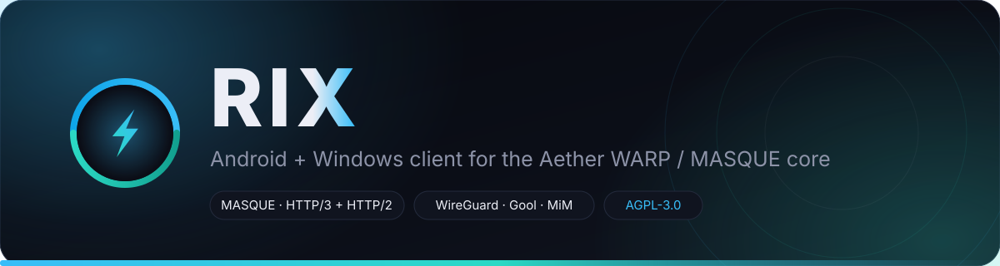
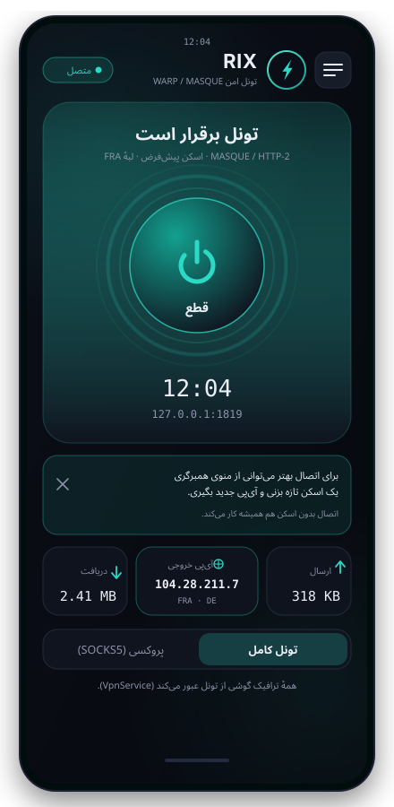
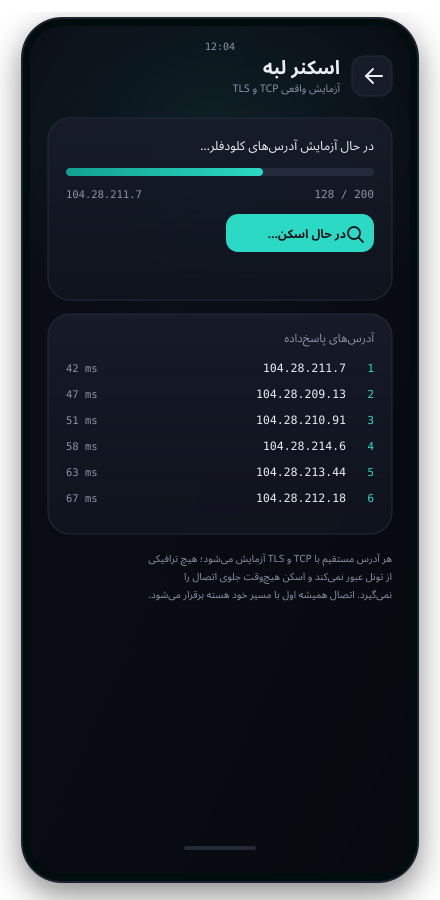
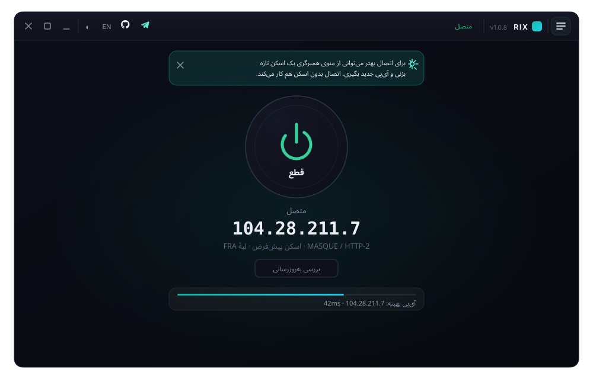
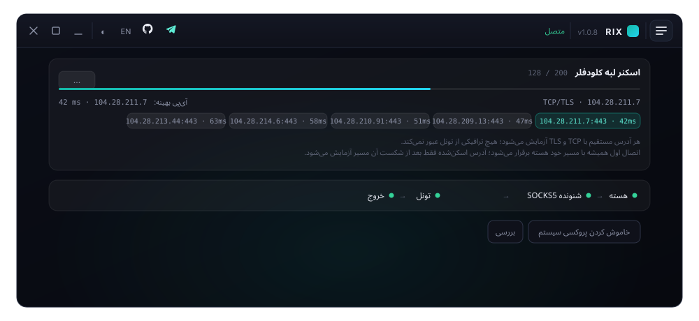
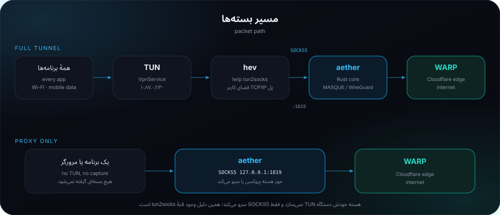

<div align="center">
  
  <h1>RIX-AETHER</h1>
  <h3>NETWORK CONTROL // ANDROID + WINDOWS</h3>
  <p><strong>A connection is only real when traffic makes it through.</strong></p>
  <p>Developed and maintained by <a href="https://github.com/rix-reza">REZA-RIX</a></p>

  <p>
    <a href="https://github.com/RIX-REZA/RIX-AETHER/releases/latest"></a>
    <a href="https://github.com/RIX-REZA/RIX-AETHER/releases"></a>
    <a href="https://github.com/RIX-REZA/RIX-AETHER/actions/workflows/android-rix.yml"></a>
  </p>
  <p>
    <a href="README.md"><strong>ENGLISH</strong></a> · <a href="README.fa.md">فارسی</a> · <a href="https://github.com/RIX-REZA/RIX-AETHER/releases/latest">DOWNLOAD</a> · <a href="https://github.com/rix-reza">DEVELOPER</a>
  </p>
</div>

---

<table>
  <tr>
    <td align="center" width="33%">
      <h3>🎯 MISSION</h3>
      <strong>Verified connectivity</strong><br>
      No fake green state. RIX verifies a real request through the tunnel.
    </td>
    <td align="center" width="33%">
      <h3>🧩 LOADOUT</h3>
      <strong>6 transport options</strong><br>
      MASQUE, HTTP/2, WireGuard and layered modes.
    </td>
    <td align="center" width="33%">
      <h3>🖥️ PLATFORMS</h3>
      <strong>Android + Windows</strong><br>
      Mobile VPN and a lightweight desktop client.
    </td>
  </tr>
</table>

## 🖼️ INTERFACE

<table>
  <tr>
    <td align="center" width="50%">
      <br>
      <sub><strong>Android · home</strong> — hamburger drawer, the connect orb, the one-time optional-scan tip and the three live tiles.</sub>
    </td>
    <td align="center" width="50%">
      <br>
      <sub><strong>Android · edge scanner</strong> — every candidate probed with real TCP + TLS/SNI, with live progress and a ranked list.</sub>
    </td>
  </tr>
  <tr>
    <td align="center" width="50%">
      <br>
      <sub><strong>Windows · home</strong> — icon-only Telegram and GitHub in the title bar, the connect dial, the exit IP and a one-line scan heartbeat.</sub>
    </td>
    <td align="center" width="50%">
      <br>
      <sub><strong>Windows · edge scanner</strong> — 128 / 200 progress, ranked address chips and the core → listener → tunnel → exit stage strip.</sub>
    </td>
  </tr>
</table>

## 🕹️ COMMAND CENTER

| 01 · START | 02 · EXPLORE | 03 · UNDER THE HOOD | 04 · SUPPORT |
|:---:|:---:|:---:|:---:|
| [Downloads](#-deployment-zone) | [Features](#-feature-unlocks) | [Architecture](#-network-map) | [Troubleshooting](#-mission-support) |
| [Quick facts](#-system-profile) | [Transports](#-transport-loadout) | [Build](#-build-lab) | [Privacy](#-privacy--permissions) |

## ⚡ DEPLOYMENT ZONE

<div align="center">
  <a href="https://github.com/RIX-REZA/RIX-AETHER/releases/latest"></a>
</div>

| Package | Latest published artifact | Notes |
|:--|:--|:--|
| **Android · ARMv7** | [`RIX-AETHER-Android-ARMv7.apk`](https://github.com/RIX-REZA/RIX-AETHER/releases/download/v1.0.8/RIX-AETHER-Android-ARMv7.apk) · 25.8 MiB | 32-bit ARM devices, `armeabi-v7a` |
| **Android · ARM64** | [`RIX-AETHER-Android-ARM64.apk`](https://github.com/RIX-REZA/RIX-AETHER/releases/download/v1.0.8/RIX-AETHER-Android-ARM64.apk) · 26.2 MiB | 64-bit ARM devices, `arm64-v8a` |
| **Android · Universal** | [`RIX-AETHER-Android-Universal.apk`](https://github.com/RIX-REZA/RIX-AETHER/releases/download/v1.0.8/RIX-AETHER-Android-Universal.apk) · 41.2 MiB | Contains both ARM ABIs; use this if unsure |
| **Windows 10 · Portable** | [`RIX-AETHER-Windows-10-Portable.zip`](https://github.com/RIX-REZA/RIX-AETHER/releases/download/v1.0.8/RIX-AETHER-Windows-10-Portable.zip) · 84.4 MiB | Extract and run; data stays in `data\` beside `RIX.exe` |
| **Windows 11 · Portable** | [`RIX-AETHER-Windows-11-Portable.zip`](https://github.com/RIX-REZA/RIX-AETHER/releases/download/v1.0.8/RIX-AETHER-Windows-11-Portable.zip) · 84.4 MiB | Same portable app; declares Windows 11 as the minimum |
| **Windows 10 · Desktop** | [`RIX-AETHER-Windows-10-Desktop-Setup.exe`](https://github.com/RIX-REZA/RIX-AETHER/releases/download/v1.0.8/RIX-AETHER-Windows-10-Desktop-Setup.exe) · 76.7 MiB | Per-user installer, Windows 10 1809 (build 17763) or newer |
| **Windows 11 · Desktop** | [`RIX-AETHER-Windows-11-Desktop-Setup.exe`](https://github.com/RIX-REZA/RIX-AETHER/releases/download/v1.0.8/RIX-AETHER-Windows-11-Desktop-Setup.exe) · 76.7 MiB | Per-user installer, Windows 11 (build 22000) or newer |
| **Checksums** | [`SHA256SUMS.txt`](https://github.com/RIX-REZA/RIX-AETHER/releases/download/v1.0.8/SHA256SUMS.txt) | Covers every artifact above; each file also has a `.sha256` sidecar |
| **Release Notes** | [v1.0.8](https://github.com/RIX-REZA/RIX-AETHER/releases/tag/v1.0.8) | Multi-platform 1.0.8 build |

<details>
  <summary><strong>📦 Release integrity · SHA-256</strong></summary>

  ```text
  f88be5e9d935b64ed2aea393c5f1f25345b54087fb36a7cd9be82f3502b93bb7  RIX-AETHER-Android-ARM64.apk
  a83f807d58046946191e87bfec4833a4713f2d44c79bce66e6e0fbf2ada37fa5  RIX-AETHER-Android-ARMv7.apk
  23acdec100dd1e01acc5f0ea003ab331f1d463465b0587da78116a627f0a2e8e  RIX-AETHER-Android-Universal.apk
  f61b43502d9f5737bfa71bc6d9233d68fb8ae81cb7292ddc205bacf427213cf2  RIX-AETHER-Windows-10-Desktop-Setup.exe
  00154ca28d654e946b5688a3ac43fc35670d73b2105763c883890bdf0d6f84c5  RIX-AETHER-Windows-10-Portable.zip
  135ec89aaff826ede3e55871f96fce25560a4119041d2f39bd943a9a8d96c4ca  RIX-AETHER-Windows-11-Desktop-Setup.exe
  00154ca28d654e946b5688a3ac43fc35670d73b2105763c883890bdf0d6f84c5  RIX-AETHER-Windows-11-Portable.zip
  ```
</details>

### 🧾 Is this build official?

Download from the [releases page](https://github.com/RIX-REZA/RIX-AETHER/releases) and nowhere else. Anything from another source is somebody else's build, however it is signed. Two checks are available for the current multi-platform artifacts:

1. **Checksum.** `SHA256SUMS.txt` covers all seven published files, and every artifact also has a `<filename>.sha256` sidecar. Compare the file you downloaded (`sha256sum -c SHA256SUMS.txt`). This catches a truncated or swapped download and nothing more — anyone can publish a matching sum for their own file.
2. **Android signature.** `apksigner verify --print-certs RIX-AETHER-Android-Universal.apk` prints `CN=RIX VPN` and the certificate SHA-256 `dc351af6…`. It proves the file was not signed by some *other* key. It does **not** prove the build is ours: that key has been public since it was committed to this repository, so a forged build can show the same fingerprint. [SECURITY.md](SECURITY.md) is the full account, and the rotation plan in it is what ends this.

The multi-platform artifacts were built by workflow run `44127338916` of `multi-platform-release.yml` at commit `5504157` (the `v1.0.8` tag) (Android native libraries and signed APKs on Linux, Windows executable and installers on a Windows x64 runner). These files do **not** have GitHub build attestations, so `gh attestation verify` is not available for this set. An attestation issued for an APK from `android-rix.yml` does not cover any file published here.

If you redistribute a modified build, [TRADEMARK.md](TRADEMARK.md) lists what has to change first — the name, the application id and the icons. Forking is allowed and this project does not try to prevent it; the name and the artwork are what stay here.

> [!NOTE]
> Version **1.0.8** fixes the Windows scanner card that could stay on "scanning" after the scan had finished, and makes the Android scanner real: every candidate is probed with TCP and a TLS handshake that includes SNI, with live progress and a ranked list. The first connect never waits for a scan — it always uses the core's own path, and a scanned address is only tried on later attempts after that path fails. The Android home screen is reduced to the header, status, connect orb and two counters; scanner, settings and log live in a hamburger drawer, and a one-time dismissible tip says scanning is optional. Purple and violet are gone from both palettes.
>
> Version **1.0.7** rebuilt the interface on both platforms and removed the cause of the Android lag: the engine's traffic counters travelled in the same state as the connection phase, so every reading rebuilt the whole screen. They now live on a flow of their own, and only the session clock and the traffic tiles follow them.
>
> The multi-platform release also ships separate ARMv7, ARM64 and Universal Android APKs, plus Windows 10 and Windows 11 portable and desktop editions. Windows is x64 only: the upstream Aether Windows core used by this version is x86_64, so no Windows ARM64 build is published.
>
> [!IMPORTANT]
> Users upgrading from **1.0.2 or older** must uninstall the old build once because those versions used a changing CI debug signature. Builds from **1.0.3 onward** use the fixed signing identity documented in the repository.

## 🏆 FEATURE UNLOCKS

<table>
  <tr>
    <td width="50%">
      <h3>🟢 REAL CONNECTION CHECK</h3>
      RIX does not mark a session as connected just because a socket opened. It waits for a real request to travel through the tunnel and return.
    </td>
    <td width="50%">
      <h3>🔁 SMART FALLBACK</h3>
      When a transport cannot prove connectivity, RIX can try a ranked fallback chain and remember the transport that worked.
    </td>
  </tr>
  <tr>
    <td>
      <h3>🧭 SPLIT TUNNEL</h3>
      Route all apps, selected apps, or all apps except the ones you choose. The RIX app is excluded from its own tunnel to avoid routing loops.
    </td>
    <td>
      <h3>📊 LIVE TELEMETRY</h3>
      View upload/download counters, packet counts, session duration and the verified egress details.
    </td>
  </tr>
  <tr>
    <td>
      <h3>🎛️ QUICK PRESETS</h3>
      Switch between five presets for default, resilient, speed, DPI-resistance and low-power use.
    </td>
    <td>
      <h3>🧰 DEEP CONTROL</h3>
      Common core settings are exposed as controls; advanced options remain available through the custom-arguments field.
    </td>
  </tr>
</table>

- 🌗 Dark, light and follow-system appearance.
- 🧾 Live, colour-coded logs that can be copied or cleared.
- 🌐 IPv4 and IPv6 tunnel routes.
- 🧪 Visible connection stages: idle, preparing, connecting, verifying, running and error.
- 🪜 A stage strip lights each hop on evidence — core, listener, Psiphon, tunnel, exit — so a listener that merely opened a port is never drawn as a tunnel.
- 🛑 A second tap on the connect button cancels an attempt that is still in flight.
- 🔒 No account, analytics SDK, ads, telemetry or crash-reporting service is built into the app, as documented by the project.

## 🧩 TRANSPORT LOADOUT

| Transport | Underlying mode | What it is useful for |
|:--|:--|:--|
| **MASQUE / HTTP-3** | QUIC / UDP | Low-latency path when UDP is available |
| **MASQUE / HTTP-2** | TLS / TCP 443 | TCP fallback when UDP is blocked |
| **WireGuard** | WireGuard | Lightweight transport where it is reachable |
| **Gool** | WireGuard inside MASQUE | Layered transport option |
| **Gool Classic** | WireGuard inside WireGuard | Alternative encapsulation mode |
| **MASQUE-in-MASQUE** | Nested MASQUE | Additional encapsulation at the cost of extra overhead |

### 🎚️ QUICK PRESET SELECTOR

| Preset | Configuration profile |
|:--|:--|
| **Default** | Core defaults with MASQUE / HTTP-3 |
| **Iran · Resilient** | MASQUE / HTTP-2 over TCP 443, fragmentation, thorough scan and fallback |
| **Fastest** | MASQUE / HTTP-3 with turbo scan and high-performance profile |
| **Anti-DPI** | MASQUE-in-MASQUE with thorough scan and fragmentation |
| **Low Power** | WireGuard with low-power profile and longer keepalive |

## 🗺️ NETWORK MAP

<div align="center">
  
</div>

### Full-device tunnel

```text
ANDROID APPS
     │
     ▼
VpnService / TUN
     │
     ▼
hev tun2socks bridge
     │
     ▼
SOCKS5 · 127.0.0.1:1819
     │
     ▼
Aether Rust core · libaether.so
     │
     ▼
WARP / MASQUE ─────────► INTERNET
```

### Connection sequence

```text
IDLE → PREPARING → CONNECTING → VERIFYING → RUNNING
                         │
                         └──────────────→ ERROR
```

1. RIX creates the TUN interface and applies addresses, DNS, routes and split-tunnel rules.
2. It selects a transport candidate: your choice, the last known-good transport, then the resilience ranking.
3. The core must open its SOCKS5 endpoint before the packet bridge is started.
4. The packet engine is started and checked.
5. A real request is sent through the local SOCKS5 path. If it does not return within the attempt budget, the next eligible candidate is tried.
6. The session clock starts only after the tunnel is verified.

<details>
  <summary><strong>⏱️ Connection budgets</strong></summary>

  | Stage | Budget |
  |:--|--:|
  | Core opens SOCKS5 | 15 s |
  | First candidate is verified | 20 s |
  | Each fallback candidate | 10 s |
  | Single probe | 6 s |
  | Candidates per attempt | 3 |
</details>

## 🎮 TWO OPERATING MODES

| Mode | Traffic capture | Use case |
|:--|:--|:--|
| **Full-device VPN** | Apps routed through Android `VpnService` | Normal device-wide VPN usage |
| **SOCKS5 Proxy** | No TUN capture | Use when another VPN owns the device or only one app needs the proxy |

## 🖥️ WINDOWS · DESKTOP STAGE

The Windows client uses the same core and transport logic, with a desktop interface.

| Item | Details |
|:--|:--|
| Interface | Borderless window drawn by an embedded WebView2 page, with rounded corners where the system provides them; the same stage strip, chart and readings as the phone |
| Languages and skins | Persian and English, light and dark |
| Installer | Two per-user setups: Windows 10 1809+ and Windows 11 22000+; no driver and no administrator prompt for the normal install path |
| Portable | Extract the ZIP and run `RIX.exe`; with `portable.marker` present, settings and data stay in `data\` beside the executable |
| Minimum OS | Windows 10 version 1809 (build 17763) for the Windows 10 build; Windows 11 (build 22000) for the Windows 11 build; x64 only |
| WebView2 | The installer and portable archive include Microsoft's bootstrapper for machines that do not have it |
| Psiphon | BETA transport chain |

> [!WARNING]
> The current Windows client configures the **per-user Windows system proxy (WinINET)**; it is not a full-device TUN VPN. Edge, Chrome, Office and other applications that respect the Windows proxy can use it. Firefox needs manual proxy configuration, and applications that open their own network sockets may bypass it. The local SOCKS5 endpoint is available for applications that support manual proxy settings.

RIX also records the previous proxy values before changing them and restores them after an interrupted session. Its core process is managed with a Windows Job Object so child processes are closed with the app.

## 🧪 SYSTEM PROFILE

| Component | Technology / requirement |
|:--|:--|
| Android UI | Kotlin · Jetpack Compose · Material 3 |
| Native core | Rust-based upstream Aether core |
| Android tunnel | `VpnService` + `hev` tun2socks + local SOCKS5 |
| Windows client | .NET desktop application |
| Android minimum | Android 7.0 · API 24 |
| Released Android ABIs | `armeabi-v7a` · `arm64-v8a` · Universal (both) |
| Windows minimum | Windows 10 1809 (build 17763) or Windows 11 (build 22000) · x64 |
| License | AGPL-3.0-only |

## 🛠️ BUILD LAB

The Android native core is built in CI because its dependencies (including BoringSSL, quiche and boringtun) require cross-compilation with the Android NDK.

```bash
# Build and validate the multi-platform release without publishing it
gh workflow run multi-platform-release.yml -f release_tag=v1.0.8 -f publish=false

# For Android-only work, the existing workflow still builds a chosen ABI list
gh workflow run android-rix.yml -f abis=arm64-v8a,armeabi-v7a
```

When the native libraries are already present locally:

```bash
gradle :app:assembleRelease -PrixAbis=armeabi-v7a,arm64-v8a
```

Windows build outline:

```powershell
dotnet publish windows/src/Rix.Windows.csproj -c Release -o windows/publish
ISCC.exe /DOutputBaseFilename=RIX-AETHER-Windows-10-Desktop-Setup /DMinWindows=10.0.17763 windows\installer\Rix.iss
ISCC.exe /DOutputBaseFilename=RIX-AETHER-Windows-11-Desktop-Setup /DMinWindows=10.0.22000 windows\installer\Rix.iss
```

See the [multi-platform release workflow](.github/workflows/multi-platform-release.yml), [Android workflow](.github/workflows/android-rix.yml) and [Windows workflow](.github/workflows/windows-rix.yml) for the complete CI build process.

## 🧯 MISSION SUPPORT

| Symptom | First thing to check |
|:--|:--|
| Nothing connects | Try **Iran · Resilient** or enable automatic protocol fallback; inspect the live log for each failed transport. |
| Stays on connecting, then errors | Read the last log lines: the tunnel may not have completed a real round trip or the core may not have opened its local port. |
| `tun2socks` stops | Reconnect and inspect the core log immediately before the stop event. |
| Proxy mode works, full tunnel does not | Check whether another Android `VpnService` is active and review split-tunnel app selection. |
| Works on Wi-Fi, not mobile data | Check UDP availability and whether the fallback reached MASQUE / HTTP-2. |
| Firefox does not use Windows proxy | Configure Firefox's proxy settings manually or point it to `127.0.0.1:1819`. |
| Battery drain | Try the **Low Power** preset and review keepalive and performance settings. |

## 🔐 PRIVACY / PERMISSIONS

The project documents that RIX has no account system, analytics SDK, ads, telemetry or crash-reporting service. Settings are stored locally. Android cleartext traffic is disabled in the manifest, and backup is disabled.

| Android permission | Purpose |
|:--|:--|
| `INTERNET`, `ACCESS_NETWORK_STATE` | Network access and connectivity state |
| `FOREGROUND_SERVICE`, `FOREGROUND_SERVICE_SPECIAL_USE` | Keep the VPN service running when the app is in the background |
| `POST_NOTIFICATIONS` | Persistent VPN notification on Android 13+ |
| `WAKE_LOCK` | Keep the tunnel active while the device sleeps |

A VPN necessarily sends traffic to the configured upstream endpoint. Review the upstream [Aether project](https://github.com/CluvexStudio/Aether) and its policies to understand that part of the network path.

## 📁 PROJECT MAP

```text
RIX-AETHER/
├── .github/workflows/       Multi-platform release + Android and Windows CI
├── app/src/main/cpp/        JNI bridge and native build files
├── app/src/main/java/       Kotlin app, core, services and UI
├── docs/                    README artwork and architecture diagrams
├── windows/                 Windows desktop client and installer
├── LICENSE                  AGPL-3.0-only
├── NOTICE                   attribution and trademark notices
├── SECURITY.md              the disclosed signing key, and what is being done
├── TRADEMARK.md             name and branding rules for redistributed builds
├── README.md                English project guide
└── README.fa.md             Persian project guide
```

## 🤝 CREDITS, LICENSE & NAMING

- **Developer:** [REZA-RIX](https://github.com/rix-reza)
- **Source repository:** [RIX-REZA / RIX-AETHER](https://github.com/RIX-REZA/RIX-AETHER)
- **Aether:** upstream Rust WARP / MASQUE core by [CluvexStudio](https://github.com/CluvexStudio/Aether).
- **hev-socks5-tunnel:** userspace TUN-to-SOCKS5 bridge.
- **Cloudflare WARP:** network service used by the upstream components.

RIX is a derivative work and is licensed under **AGPL-3.0-only**. See [LICENSE](LICENSE) and [NOTICE](NOTICE). The application itself is named **RIX**. The repository name identifies its integration context; it does not imply ownership of, or endorsement by, the upstream Aether project. The upstream naming and trademark policy applies; do not present Aether as the app's own brand without written permission from the relevant rights holder.

This project's own name and artwork are covered by [TRADEMARK.md](TRADEMARK.md), which also states what a redistribution has to change. Those requirements are the additional terms this project sets under AGPL section 7(b) (preserve the notices) and 7(e) (no trademark licence), and they are the reason a fork publishes under its own name rather than this one.

---

<div align="center">
  <strong>RIX-AETHER // BUILT BY REZA-RIX</strong><br>
  <sub>Built for networks that fight back.</sub><br><br>
  <a href="https://github.com/RIX-REZA/RIX-AETHER/stargazers">⭐ Star the project</a> ·
  <a href="https://github.com/RIX-REZA/RIX-AETHER/issues">🐛 Report an issue</a> ·
  <a href="https://github.com/RIX-REZA/RIX-AETHER/releases">🚀 View releases</a>
</div>
